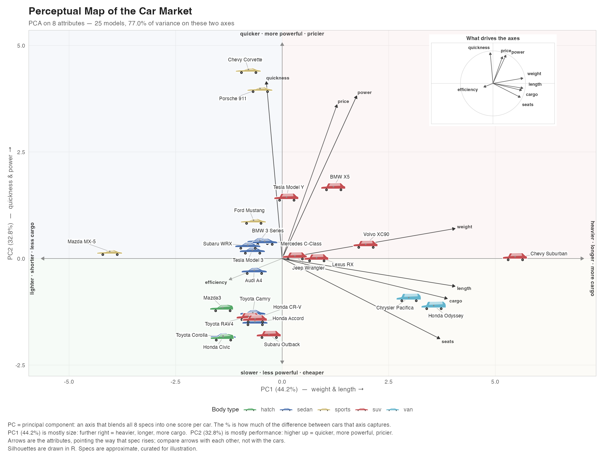

# Car Perceptual Map — presentation copy

A trimmed copy of [the full project](https://github.com/Azlan-A1/perceptual_map):
the raw-data and loadings tables are not exposed, and How it works keeps only
its first three sections. The map itself is identical.

A perceptual map of the car market, built in R. Cars are positioned by PCA on
their objective specs and drawn as silhouettes rendered directly by `grid` — no
image files, no downloads, no licensing questions. Runs offline.



## Run it

Open the project in RStudio, then:

```r
source("setup.R")        # check packages (reports only, never installs)
source("run_static.R")   # static map -> Plots pane + outputs/map.png|pdf
shiny::runApp()          # the interactive app (or click "Run App")
```

Everything runs on packages you already have: **ggplot2, shiny, bslib,
patchwork, scales, grid**, with **ragg** optional. Nothing to install.

### Any directory, any platform

`app.R` and `run_static.R` locate the project themselves, so neither depends on
the working directory. They check the path R was given on the command line, then
the file being `source()`d, then the working directory, and walk up to the folder
holding `R/` and `data/cars.csv`. All of these work from anywhere:

```r
shiny::runApp("~/perceptual_map")          # or RStudio's Run App
source("~/perceptual_map/run_static.R")    # writes into the project, not your cwd
```
```bash
Rscript ~/perceptual_map/run_static.R      # from any folder
```

Exports always land in the project's `outputs/`, never in the directory you
happened to start from.

### Windows, macOS or Linux

The project is plain R with relative paths, so it runs the same on all three.
Two platform details are handled rather than assumed:

- **Text encoding.** Every R source file is pure ASCII; the dashes, arrows and
  middle dots in the plot are `\uXXXX` escapes, so they survive whatever
  encoding the machine reads the files with. On Windows they render correctly
  from R 4.2, which is where UTF-8 became the native encoding; `setup.R` says so
  if you are on an older build.
- **Devices.** `ragg` is used for PNG export when installed and the stock device
  otherwise. The PDF export prefers `cairo_pdf` and falls back to the base
  device with a message that names the right fix for your platform (cairo ships
  with R on Windows; macOS needs XQuartz).

## The app

- **Attributes** — tick attributes in or out; the PCA refits and the map moves.
- **Axes** — plot any pair of PC1–PC4.
- **Zoom** — drag a box, then double-click. Double-click empty space to reset.
  Because silhouettes are sized in *points*, not data units, zooming genuinely
  spreads a crowded cluster apart instead of magnifying it.
- **Click a car** for its spec card.
- **Direction labels** at the four ends of the crosshair say what moving that
  way means — e.g. *heavier · more cargo · longer* on the right. They are
  recomputed from the loadings whenever you change attributes or axes, drop
  their weakest words on a narrow window, and sit in a band of their own so car
  labels never land on them.
- **Attribute arrows** are drawn on the map from the centre out, so cars and
  specs can be read together — the Suburban lies along *cargo* and *weight*,
  the Corvette along *quickness*. Arrows share one scale factor, so they are
  comparable with each other but not with the cars' positions; their labels
  slide along their own shaft to stay clear of the cars.
- **Axis key** under the map defines the terms: *PC* is a principal component
  (an axis blending all the specs into one score) and the percentage is how
  much of the difference between cars that axis captures. It then names what
  each axis on screen mostly measures — e.g. *PC1 (41.4%) is mostly size*.
- **Labels never overlap**, at any window size. Each car's name takes the
  first clear spot near it, most distinctive cars first. On a narrow window the
  label text shrinks just enough for every name to fit, down to a 5pt floor;
  all 25 still fit at a 450px-wide plot. Below that, any name with no room is
  left off and the key says how many — zoom in or widen the window to bring
  them back.
- **Body types**, silhouette size, labels, quadrant shading, hulls.
- **Light / dark toggle** in the header. It themes the entire app — chrome,
  cards, tables, both plots, and the downloaded PNG — not just the map.
- Two other tabs: **Variance**, the scree plot of every component, and
  **How it works**, a three-section explanation of the pipeline — the data and
  its transforms, why the specs are standardised, and what PC1, PC2 and the
  rest are, with a live table of every component.
- **Download PNG** exports the current view at 200 dpi.

## How the map is built

`fit_map()` scales every attribute, runs `stats::prcomp`, and pins each axis's
sign so the map is identical on every run. Two transforms happen first:

- `0-60` is negated, so every arrow points the intuitive way ("more is more").
- `mpg` is log-transformed. EV MPGe (122–132) against petrol MPG (18–36) would
  otherwise turn that variable into an "is it an EV" indicator that contributes
  almost nothing to the first two components.

Arrows in the compass are **variable–score correlations**, not raw eigenvectors.
That is the correlation-biplot scaling: everything sits inside the unit circle,
and an arrow's length is how well that attribute is represented on the two axes
on screen.

With all 8 attributes: **PC1 41.4%** (weight, cargo, length, seats — size and
utility) and **PC2 32.1%** (quickness, power, price — performance and price),
so **73.5%** of the variance is on the two axes you see.

## Files

| Path | What it does |
|---|---|
| `data/cars.csv` | 25 models x 8 attributes. Edit or extend it; nothing else needs changing. |
| `R/silhouettes.R` | Body-type polygon shapes, `car_grob()`, and the `GeomCar` ggplot2 geom. |
| `R/pca.R` | `fit_map()`, transforms, sign pinning, `axis_name()`. |
| `R/layout.R` | Layout measurement, aspect fitting, label and arrow placement, inset corner picking. |
| `R/plot.R` | `build_map()`, `build_compass()`, `compose_map()`, `pm_bg()`, theming. |
| `R/explain.R` | The How it works tab, generated from `CARS` / `ATTRS` so it cannot go stale. |
| `app.R` | The Shiny app. |
| `run_static.R` | Static export. |
| `setup.R` | Package check. |

## Two implementation notes

**Why a custom Geom rather than `annotation_custom()`.** `annotation_custom()`
is not vectorised — passing vectors to `xmin`/`xmax` is a hard error in
ggplot2 4.0 — so it needs one layer per car and replicates into every facet.
More importantly it sizes in data units, so cars grow as you zoom and a dense
cluster never decongests. `GeomCar` emits one grob per row in a single layer,
sized in points.

**Why the compass is an inset in the static map but a side panel in the app.**
A `patchwork` inset overrides the plot's coordmap, so Shiny resolves clicks and
brushes against the *inset's* scales instead of the map's. The static export has
no interaction, so it keeps the inset; the app renders the compass separately
and leaves the map a plain `ggplot`.

## Caveats

The specs are hand-curated approximations of 2020s models, assembled to make a
readable market map — not an authoritative spec database. Swap in your own
numbers in `data/cars.csv`.

`gt::gtcars` is an alternative real, citable dataset, but it is supercar-heavy
(Ferrari, Lamborghini, Aston Martin, 2014–2017) with no Corolla or F-150, so it
cannot show mainstream market spread.

## License

[MIT](LICENSE) © 2026 Azlan Ahmad

The car specifications in `data/cars.csv` are hand-compiled approximations
assembled for illustration, not licensed data from any manufacturer or
third-party database.
